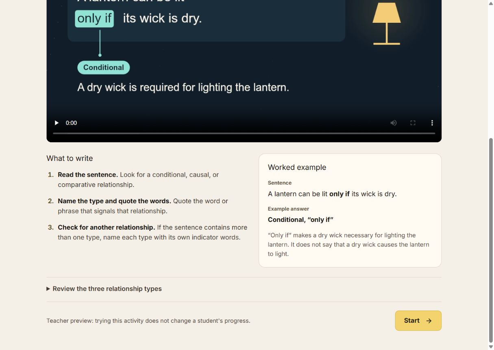
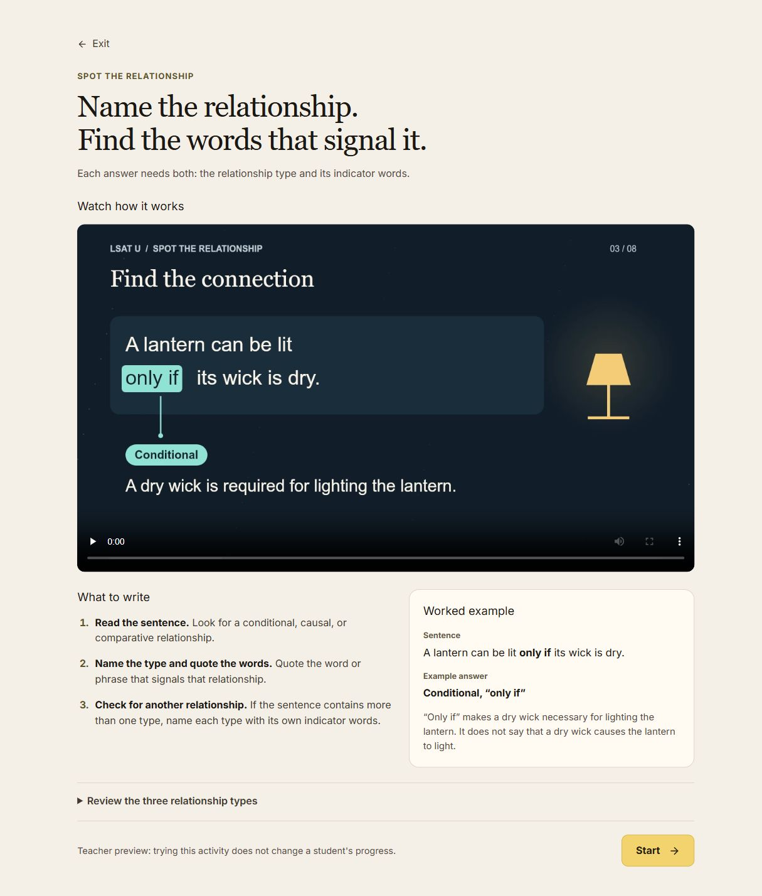
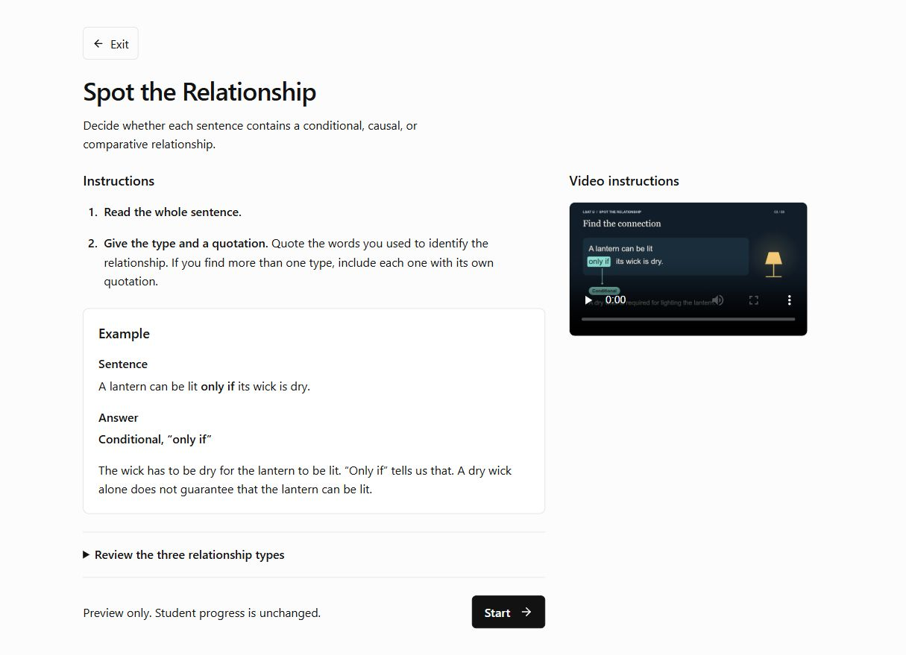

# Spot introduction: visual correction record

Joshua's annotated live-page feedback on 2026-10-16 is the source for this correction. [DESIGN.md](../../../DESIGN.md) owns reusable rules and the [activity surface brief](../../../.impeccable/surfaces/src-features-activity-centre.md) owns the exact scope. This page preserves evidence rather than establishing another design standard.

| Rejected presentation | Revised direction | Reason |
| --- | --- | --- |
| Tiny uppercase activity name, oversized slogan, small subtitle | One modest activity title and readable instructions | The student should not have to decode three competing levels of display copy. |
| Name the relationship / Find the words that signal it | Complete task instructions, checked aloud in context | A slogan and an abstract synonym do not explain what to do. Signal is not globally banned. |
| Worked example; What to write | Example; Instructions | Use ordinary student language. |
| Full-width video before the task | Written instructions/example first; smaller supplementary inline video | Students can understand the task without watching. |
| Gold Start on beige, brown text | Existing neutral semantic surfaces and high-contrast primary control | Restraint, readable type and contrast supply the quality. Beige is not globally banned. |

## Before

Responsive before references are captured from a separate signed-in teacher-preview tab, without starting a run or changing student records. The original user tab is preserved. Width labels are verified against the actual DOM viewport rather than the requested emulation size alone.

## Revised local component

| Live reference, 1230px | Revised local component, 1230px |
| --- | --- |
|  |  |

| Actual DOM width | Before | After | Result |
| --- | --- | --- | --- |
| 390px | [Phone](before-390.png) | [Phone](after-390.png) | No horizontal overflow; written task and action precede video. Scrolling is expected. |
| 520px | [Docked](before-520.png) | [Docked](after-520.png) | Single column, full-width 44px-high action; video remains supplementary. |
| 768px | [Tablet](before-768.png) | [Tablet](after-768.png) | Single column with a capped 340px video, not an oversized full-width film. |
| 1230px | [Desktop](before-1230.png) | [Desktop](after-1230.png) | Written column plus 320px video rail; Start ends at approximately843px in an874px measured viewport. |

[Measured geometry and computed styles](layout-measurements.json) confirm 16px body text, 28px narrow /34px desktop title, Lexend/Outfit UI family, 44px controls and no horizontal overflow at all four widths. The viewport request was873px high; the browser reported874px, recorded rather than rounded away. Both text and primary button use rgb(18,18,18) against rgb(252,252,252), approximately18.26:1 contrast. Activity Centre is deliberately always light, including beneath dark root tokens. The first fixture omitted activity-centre.css; independent inspection caught that integration mistake before push. The corrected fixture imports the actual stylesheet, and the Spot entry explicitly overrides its warm semantic tokens with the established neutral Workroom light values. The [older isolated dark fixture](after-root-dark-resume.png) is preserved as superseded evidence of that fixture mistake, not a production state. The corrected host-root resume screenshot is linked below.

Keyboard checking reached Back to question7 after Exit and the relationship reference, with a visible outline. Clicking it invoked the local-only callback. Unit tests cover video error text, captions/no autoplay, preview/save modes, Exit/Start/resume and rejected-copy absence. Visual checks do not establish production persistence or live AI grading.

Local fixture: `/src/dev/relationship-intro-preview.html` renders the actual RelationshipIntro component. Its Start/Exit callbacks are local status messages and do not simulate persisted grading. `?resume=7` checks the resume label; `?theme=root` checks the actual always-light Activity Centre beneath dark ancestor tokens; the default fixture uses `.light`. Both now import the real Activity Centre stylesheet.

The source change and independent review are not publication proof or Joshua's visual approval. The instructional film/poster/captions are retained; the gold lamp inside that existing film is separate from the rejected page control palette.

## Integration correction

The final after-size matrix was regenerated after importing activity-centre.css and overriding its local warm tokens for this entry. [Always-light activity beneath dark ancestor tokens, with resume](after-host-root-resume.png). The older after-root-dark-resume.png is intentionally retained with the limitation above. A fixed dark video backdrop avoids a white letterbox; the intro focus rule suppresses the inherited emerald halo while retaining a clear neutral outline.

## 2026-10-18: expand video on click

Video now expands from its small inline position over 450ms to a native modal, capped at 960px and fitted to the viewport. Close button, Escape, backdrop dismissal, reduced motion, and return focus are supported. Same mounted video preserves its playback position. Browser checked at 390, 658, 768 and 1280 pixels with no horizontal overflow; actual playback observed advancing. Screenshot: video-expanded-2026-10-18.png. Local preview only; not deployed.

