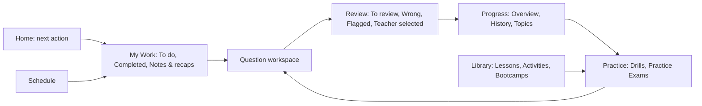

# LSAT U platform adoption game plan

Date: 2026-09-27
Status: approved design direction; implementation started 2026-09-28, with ticket-by-ticket verification required
Source: [LSAT Lab, 7Sage, AdeptLR, and LSAT Demon running audit](../audits/2026-09-27-competitor-ui-audit.md)

Student-facing companion: [2026-09-28 student experience design and clickable prototype](../design-briefs/2026-09-28-student-experience.md). It maps every current student rail item from Joshua's screenshot into the proposed seven-page shell, including persistent Inbox and question search.

Decision tracking: [Wayfinder decision map](https://github.com/vnjkoxpl-42905/lsatu-684d89db/issues/155) is resolved. The [implementation spec](https://github.com/vnjkoxpl-42905/lsatu-684d89db/issues/165) and [ordered build sequence](2026-09-28-connected-experience-sequence.md) carry the approved design into student-first, blocker-aware tickets. This document remains the design direction.

The [route and saved-rail decision](https://github.com/vnjkoxpl-42905/lsatu-684d89db/issues/157) sets stable paths for the seven destinations and local tabs, preserves old question and work links, and migrates saved rail choices once. Joshua has chosen to lock unfinished Admissions for students now while retaining Joshua/admin access; the [Admissions access ticket](https://github.com/vnjkoxpl-42905/lsatu-684d89db/issues/164) tracks the live change.

## The product we should build

Make LSAT U feel like one coached study system. A student should see what Joshua assigned, do it, inspect a missed question, understand the error, and know what to do next without hunting through the rail. Joshua should see the same attempt and review state from his workspace and connect it to the next session.

The competitor takeaway is a combination, not a replica: LSAT Demon's focused review loop and short expanding rail; 7Sage's summary followed by detail, training modes, and transparent priorities; AdeptLR's calm question canvas, live pool count, and separate feedback controls; LSAT Lab's structured weekly work, question finder, and small reasoning exercises. LSAT U's advantage is Joshua's personal assignment, written teaching, recap, and follow-up on the *same* work.

This document was drafted for design and implementation sequencing. Joshua requested the full build and deployment on 2026-09-28. A Lovable action that may spend credits still needs his confirmation immediately before that action, and no unverified ticket may be reported as deployed.

## Decisions and corrections that govern the design

1. **The 2026-09-27 navigation decision wins:** My Work contains To do, Completed, and Notes & recaps. Review groups wrong and flagged work. Progress groups analytics and history. Notes and recaps remain distinct records. This supersedes the older draft's rail rename to “Notes,” while preserving its underlying recap type.
2. **Keep the existing teacher desk.** Source inspection found four current teacher rooms, Today, Inbox, Library, and Insights. Library already has Bootcamps and Activities as separate URL-backed tabs. Improve these rooms and add a clear View student experience action. Do not rebuild the teacher rail as the earlier audit's speculative Students, Plans, Library, Schedule list.
3. **Keep Practice Exams intact inside Practice.** Joshua confirmed on 2026-09-28 that the student rail can use Practice as one destination, with Drills and Practice Exams as distinct first-level areas. Practice Exams retains the previously approved Overview landing page with full PrepTest and timed-section start actions, Unfinished exams and sections, All Exams, and Attempts. Timed work keeps a deliberate start step and timing summary.
4. **Extend the current question journal.** It already has question/review views, saved reasoning, annotation, and Ask. Build a shared Review workspace around it, with content adapters for LR, RC, Activities, and bootcamps. Do not assume every item has an LR bank ID.
5. **Preserve approved Home v3.** Its insight-first diagnosis, accurate LR charts, Assigned to you, conditional From Joshua, next seven days, and sparse/error states remain the base. This plan adds navigation and review connections; it does not replace the approved Home brief with a competitor dashboard.
6. **Layer on the existing drill builder brief.** The 2026-09-26 draft calls for one Choose questions area, guaranteed exact PT/S/Q picks, four filter dimensions, honest available count, and preview. Add feedback cadence, answer reveal, and mode labels to that design. Its draft status remains visible until Joshua settles it.
7. **Treat the analytics rebuild as a dependency, not a finished feature.** Its taxonomy fix is marked done; identity, flags, assignment attribution, history coverage, and shared student/teacher analytics remain open. Its proposed 3D hero conflicts with an action-led first screen. Preserve the idea for a later measured prototype; keep readable 2D evidence and tables first.
8. **No new videos in this phase.** Use written explanations, worked examples, existing material, and bounded Activities. Group classes, a broad forum, leaderboards, meditation, and a large video catalog do not fit the present one-to-one offer.

## What we adopt, in priority order

Each row names a product outcome. “Reuse” means source code already exists; it does not assert that its live behavior is complete.

| Order | Adopt or adapt | Source pattern | LSAT U implementation | Why here |
|---|---|---|---|---|
| P0.1 | One truthful work and question record | All four make history, review, and metrics central | Normalize attempt, question identity, assignment origin, flag, note, mode, and completion across LR, RC, testing, Activities, and bootcamps. Reconcile user/class identity and show uncovered sources explicitly. | Every later count, queue, and teacher view depends on this. |
| P0.2 | One flag and review eligibility contract | Demon Review Inbox; 7Sage review rules | A missed attempt, student flag, post-session skip, or explicit Joshua selection creates a Review task with a reason and source attempt. Keep the flag separate from the task. Use a typed reference for LR, RC, Activity, and bootcamp items. | A unified Review page must be trustworthy. |
| P1.1 | Short labeled student rail with local navigation | Demon rail; 7Sage grouped Study; AdeptLR restraint | Replace the flat 14-item student rail with Home, My Work, Practice, Review, Progress, Library, Schedule. Use page tabs or a short local submenu. Keep search visible. | Directly solves Joshua's reported navigation overload. |
| P1.2 | One My Work page | LSAT Lab weekly plan; 7Sage resume | To do, Completed, Notes & recaps tabs. Show Joshua's assignment, estimated size if reliable, due/status, Continue, linked recap, and next step. | Students need one reliable answer to “what did Joshua give me?” |
| P1.3 | Review queue and focused question workspace | Demon queue/checklist; 7Sage first/Blind Review; AdeptLR written per-choice explanations | To review first, with Wrong answers, Flagged, and teacher-selected filters. Preserve first and blind answers. Ask the student to diagnose the tempting wrong choice and proof for the right one before marking Done. Keep Joshua's note attached. | This is the highest teaching-value interaction after assigned work. |
| P1.4 | Practice with a complete Practice Exams area | LexPrep exam structure; 7Sage practice grouping; Demon section/test cards | Practice has Drills and Practice Exams. Drills includes saved sets. Practice Exams has Overview, All Exams, and Attempts; Overview shows two start actions and one unfinished list for full exams and standalone timed sections. All Exams has PrepTest detail pages. Continue sits next to Start, and a timed launch confirms duration, accommodations, source, and access. | Reclaims a rail item while preserving Joshua's approved exam structure and deliberate timed boundary. |
| P1.5 | Better drill setup and inspect path | AdeptLR pool count/feedback controls; Demon Challenge/View Only; 7Sage Customize | Keep Smart Drill one click. Manual setup shows unit, count, time, freshness, available pool, preview, and optional Customize. Separate pause-for-review from auto-reveal. Opening a known question offers Practice or Inspect; Inspect never scores an attempt. | Improves a frequent action without rebuilding the question engine. |
| P1.6 | Progress page with evidence linked to action | 7Sage priorities; LSAT Lab breakdowns; Demon quality-to-lesson links | Overview, History, and Topics local tabs. One time filter drives every measure. Show sample size, source, and missing coverage. A priority explains why it matters, then links to Review and a prefilled drill. | Diagnosis becomes useful only when it leads to a specific next action. |
| P1.7 | Home connection to the new system | LSAT Lab next steps; AdeptLR single action; approved LSAT U Home v3 | Preserve Home v3 layout. Make its first recommendation Joshua-approved and link it to My Work, Review, or Practice with a visible reason and finish condition. | Home is an entry point, not another history or analytics page. |
| P1.8 | Teacher view of the same state | LSAT Lab tutor authoring; 7Sage tutor shell, with limited populated evidence | In current Today/Inbox/Library/Insights and each student dossier, show overdue work, last attempt, review due, and next session using the same data contract. Add View student experience with full teacher/admin controls in the selected student's context. Teacher answers remain separate from that student's score and history. | Joshua should see and act on the student's state without losing his teacher authority or changing the student's results by practicing himself. |
| P1.9 | Text-first Activities and Library resume | LSAT Lab skills; Demon Skills; 7Sage lesson progress | Keep existing Activities and bootcamps. Give each bounded exercise a named reasoning operation, instructions, item count, finish rule, written feedback, Continue, and teacher assignment link. | Fits Joshua's teaching and needs no new filming. |
| P2.1 | Session preparation chain | 7Sage pre-class drill; Demon exact-question syllabus | Schedule links to preparation questions; the session links to a recap; the recap links to follow-up work. Show this chain in My Work and the teacher dossier. | Differentiates LSAT U as a coached product. |
| P2.2 | Topic hubs and written resource finding | LSAT Lab topic pages; 7Sage outline; Demon resources | One pilot LR topic page shows Joshua's written rule, worked example, related Activity, student's evidence, and a direct drill. Search and Continue lead into the wider Library. | Make the large curriculum browsable after the core loop works. |
| P2.3 | Study settings that affect interpretation | 7Sage review preferences; Demon accommodations/high contrast; AdeptLR test profile | Timing accommodation, feedback mode, review rules, analytics inclusion, contrast, and text size live in a short settings area with consequence copy. Save mode/source on attempts. | These controls should not silently change scores or recommendations. |
| P3 | Capacity-aware weekly plan and outside results | 7Sage planning; LSAT Lab weekly grouping and LawHub import | Let students state realistic available hours while Joshua retains plan authority. Consider outside test import only after demand, rights, consent, identity mapping, and metric provenance are clear. | Valuable later, but neither is required to fix navigation and review. |

### Small interactions that belong inside those releases

| Priority | Detail | Placement |
|---|---|---|
| P1 | Keep a visible Find question shortcut for exact PT/S/Q and text search; preserve the source filter and return destination when the question closes. | Global header, teacher dossier, Review, Progress. |
| P1 | State Selected, Your first answer, Blind answer, Correct answer, and Reviewed in text as well as color. | Question workspace and result rows. |
| P1 | Show question/passage unit, available pool, estimated time if reliable, and the actual launched count before Start. | Practice builder and saved set card. |
| P1 | Put Continue beside Start, then show a small completed list with Results and Review. | Drill, Timed Sections, PrepTests, Activities. |
| P1 | Show a compact section/test result first, then expand the question table with source, first/BR answer, time, flag, note, and review state. | Practice results; full table also in Progress. |
| P1 | Explain why an item is in Review and what Mark reviewed does; an empty queue has a useful next action. | Review list and question footer. |
| P2 | Let a student bookmark a useful question or lesson without treating it as a wrong answer. | Question workspace, Library, saved list. |
| P2 | Keep passage find, text highlighting, and optional answer elimination where those help reasoning; keep them accessible on keyboard and touch. | Question workspace. |
| P2 | Let Joshua attach or choose a second written explanation when it genuinely clarifies a different reasoning path. Show author and date. | Contextual explanation pane. |
| P2 | Explain the consequence of a preference at its control, especially accommodations, auto-reveal, and analytics inclusion. | Settings and launch confirmation. |

### What we deliberately leave out

- Response-popularity percentages and predicted scores: they appear precise without necessarily helping a student reason, and LSAT U lacks a validated comparison model.
- Large zero-state gauges and long default tables: use a next action and a compact summary, with Details for Joshua and power users.
- Broad discussion forums, peer leaderboards, generic streak pressure, tutor marketplaces, and a group-class catalog: each needs an operating model that LSAT U does not currently have.
- A 3D analytics hero in the first release: the earlier draft records this design choice. Keep it as a separate prototype after data coverage, laptop/mobile performance, and its effect on the first screen are measured.
- New video production: existing videos may remain optional, but no stage in this plan depends on recording.

## The interface design

### Navigation map

The diagram shows the common study loop, not mandatory clicks. Every destination remains directly reachable from the rail and from a deep link.

### The global shell

**Proposed desktop:** a 256 px labeled rail, one content canvas, and local tabs under the page title. The current 336 px rail plus optional 336 px section column can consume 672 px before the content. Remove that permanent second column; put its controls inside the page. Use the current warm white surface, charcoal text, amber action color, Outfit body type, and IBM Plex Mono for small metadata. These are LSAT U's own tokens, not a competitor color copy. Keep the teacher desk's distinct existing shell.

**Proposed width behavior:** at 1280 px and above, keep the labeled rail and a content region up to the current 1240 to 1260 px wide-page precedent. From 1024 to 1279 px, use a narrower rail or compact labels and in-page tabs. Below 1024 px, use the existing 56 px mobile header and drawer. All tap targets stay at least 44 px high. Validate the exact widths in the running app before freezing tokens.

**Page template:** title and one primary action in the first row; a short local tab row under it; a concise summary or next action; then a scannable list. Search and advanced filters open in context. Counts are shown only when the underlying ledger is complete. A link copied from a tab or filter opens that same state again.

| Proposed layout token | Target for the prototype | Reason |
|---|---|---|
| Student rail width | 256 px wide, reducing to about 224 px at mid-width | Reclaims space from today's 336 px rail without forcing icon-only labels. |
| Extra section column | None in the steady state | In-page tabs and filters replace the current second 336 px column. |
| Page gutter | 32 px desktop, 20 px mid-width, 16 px phone | Keeps dense data readable while leaving room for LSAT text. |
| Question explanation pane | At least 320 px when shown beside the question | Avoids the cramped right column seen in the Demon review. |
| Tap and click target | At least 44 px high for key controls | Matches LSAT U's existing coarse-pointer rule. |
| Card corner and color | Reuse the current 8 px radius and classroom color variables | Keeps the redesign recognizably LSAT U. |

These are design targets, not claims about current code. Compare them with the existing shell at each verification width and adjust based on actual reading space.

### Page designs

| Page | First screen | Deeper view and state |
|---|---|---|
| Home | Joshua's recommended next step, why it is next, estimated size if reliable, Resume/Start, and a compact review-due/next-session row. Preserve the approved Home v3 insight and charts. | Assigned to you, conditional From Joshua, next seven days, and linked progress evidence. Sparse data shows an honest starter action, not a fabricated rating. |
| My Work | To do count, next assignment, Continue, status, due date when one exists. | Completed and Notes & recaps tabs, with source assignment, linked session, teacher note, and student response. A recap is not mislabeled as an assignment. |
| Practice | Drills and Practice Exams are the two first-level areas. Practice Exams Overview shows full PrepTest and timed-section start actions plus Unfinished exams and sections. | Drills holds Smart Drill, Choose questions, and Saved sets. Practice Exams has All Exams with PrepTest detail pages, and Attempts with in-progress/completed full exams and timed sections. Timed start has an explicit final summary. |
| Review | To review queue with reason chips such as Missed, Flagged, Skipped, or From Joshua; oldest or most relevant few rows first. | Wrong answers, Flagged, and Advanced table filters. Question view retains first answer and source, optional blind answer, notes, explanation, Ask Joshua, checklist, Reveal, Mark reviewed, and return to filtered queue. |
| Progress | Top three supported priorities with attempt count, trend, Review and Practice actions. | Overview, History, Topics. Date control follows the existing 7/14/21/30/All decision. Dense history table includes source, mode, assignment, result, time, flag, and review state; filters live in the URL. |
| Library | Continue current lesson or activity, then small groups of relevant written resources. | Searchable topic index, Bootcamps and Activities, with progress, instructions, finish state, and direct practice links. |
| Schedule | Next one-to-one session, timezone, and any assigned preparation. | Past session recaps and follow-up links connect back to My Work. |
| Teacher desk | Preserve Today, Inbox, Library, Insights. Today foregrounds students needing an action. | Library keeps separate Bootcamps and Activities tabs. Student dossier keeps its existing Overview, Work, Notes, Messages, Schedule tabs and links to the student's Review and Progress state. View student experience opens that student's pages in clearly labeled Teacher mode with teacher/admin actions available. |

### Question workspace behavior

1. **Entry:** Start Challenge records an attempt; Inspect is read-only for performance. The entry screen states which path the student is choosing.
2. **Before answer:** show passage/stimulus and choices with Joshua's preferred training prompt only in a named Training mode. The mode is saved on the attempt. A timed Test mode removes coaching prompts.
3. **Answer selection:** show Selected without calling it Correct or Wrong. Keep a distinct Submit action when the mode requires it. Pause for review and auto-reveal are separate settings.
4. **After answer:** retain the first choice. If Blind Review is active, capture the second choice before Reveal. Reveal then labels Your answer and Correct answer in words and color.
5. **Review:** place written reasoning beside the question where width allows. Start with the gap or proof, then short A through E reasons. The checklist asks what made the chosen wrong answer tempting and what exact words disprove it; it also asks why the right answer follows. Student notes and Joshua's feedback remain attached to the attempt.
6. **Finish:** Mark reviewed requires an intentional action and returns to the same filtered queue. A later reattempt is a new attempt linked to the earlier one.

At wide desktop sizes, use stimulus, choices, and an explanation pane with a readable minimum width. At ordinary laptop widths, use stimulus plus choices, then an adjustable explanation panel or a full-width explanation reading state. On a phone, stack passage, question, and explanation with clear jump controls and preserved scroll positions. Do not shrink LSAT text to force three columns.

### Contracts the implementation must share

- **Question reference:** one typed reference identifies an LR bank item, RC passage/question, Activity item, or bootcamp item. A question view receives that reference plus an attempt context, instead of assuming an LR `qid`.
- **Attempt:** store student identity, source, assignment link when present, practice mode, first answer, blind-review answer when present, timing condition, result, and timestamps. An Inspect visit has no scored attempt. Reattempts have new IDs and link to the prior question.
- **Review item:** one record or derived view carries a typed content reference, source attempt, one or more entry reasons, queued/reviewed state, and the student's written diagnosis. A missed answer requires a short explanation of the error and the right answer before Mark reviewed; writing is optional for a flag or skip without a miss. Mark reviewed clears the task without removing the independent flag or answer history. A later miss creates a new task and preserves the earlier review. Joshua's note is linked to the same question and student. The [Review decision](https://github.com/vnjkoxpl-42905/lsatu-684d89db/issues/159) holds the source-specific rules and coverage limits.
- **Assignment and recap:** assigned-but-not-started work must exist in the work ledger even with no attempt. Keep each issued assignment, including repeat guided drills. Viewing work alone does not start it; measurable practice completes only after a saved finish or submission. Overdue unfinished work remains To do and may still be completed. Open-ended preparation may use an attributed Mark done action. Joshua's notes, session and smartboard recaps, and the student's own notes remain typed reading records in Notes & recaps, labeled by author and type, rather than being counted as completed assignments. The [My Work decision](https://github.com/vnjkoxpl-42905/lsatu-684d89db/issues/158) holds the full status and scope contract.
- **Metrics:** use one student-scoped, typed attempt ledger for Progress and its teacher view. Diagnostic accuracy uses the student's first saved, graded answer to each distinct LR or RC question; a repeat is a separate history/volume event and cannot improve that first-answer measure. Inspect visits, blind-review answers, and unfinished ungraded work do not enter the accuracy denominator. Show LR and RC separately rather than blending unlike work; Activities and bootcamps retain their own completion and source-specific results. Each percentage displays its correct count, eligible-question denominator, included source/mode coverage, and selected timeframe. Keep the approved 7/14/21/30/All control on both statistics and history. With fewer than three eligible questions in a breakdown, show the count and "not enough evidence" instead of a percentage or priority; label three to nine as an early signal. Assignment attribution requires a stored assignment link, never a guess from timing. Missing sources are named, and teacher/student views use the same reducer under authorized student scope. The [Progress decision](https://github.com/vnjkoxpl-42905/lsatu-684d89db/issues/161) records Joshua's acceptance and the source mismatches this replaces.
- **Teacher mode:** View student experience selects one student but keeps Joshua or the admin signed in under their own account and keeps all teacher/admin controls available. A persistent banner names the selected student and Teacher mode; the dossier and Today show the same assignment, last-attempt, review-due, and next-session state as the student-facing pages. Teacher/admin changes to a student's work are attributed to the acting teacher/admin. If Joshua answers a question, that is teacher practice under his account and never enters the student's attempts, score, History, completion, or Review queue. Server-authorized, student-scoped read and write paths enforce these rules; changing the visible UI or swapping the auth session is insufficient. This supersedes the earlier read-only preview proposal. The [teacher scope decision](https://github.com/vnjkoxpl-42905/lsatu-684d89db/issues/162) records Joshua's correction.
- **Navigation:** each local tab and filter has a stable URL. Existing links and saved rail customization are migrated deliberately. All tabs stay visible; unavailable tabs show a lock and retain their current permission gates, including on direct links.

### States and accessibility

Every page needs loading, empty, permission-limited, partial-data, error, and complete states. Empty is not zero accuracy. An inaccessible tab stays visible with a lock, cannot open its page, and has an accessible explanation of its state; a parent page never grants a child permission. A locked direct link is denied. Keep focus visible, local tabs keyboard-operable, color states labeled, page landmarks present, and reduced-motion behavior respected. Test the rail, filters, question workspace, and teacher preview with keyboard, screen reader, mobile, mid-width laptop, wide desktop, zoom, and the sidecar-docked case.

## Build sequence with exit gates

| Release slice | Concrete work | Exit gate |
|---|---|---|
| 0. Shared truth | Reconcile student identity; define canonical question/attempt/source/mode/assignment/flag/review states; repair missing RC, Activity, bootcamp, and assigned-work coverage; migrate local-only bootcamp progress idempotently. Make new full-exam attempts account-backed and conflict-safe. A failed account save keeps a device backup and pauses the exam and clock visibly until saving works. Keep older browser-only runs without owner identity separate from automatic migration. Build one student/teacher read model. | Sample students have matching counts and the same question state in journal, history, flags, teacher dossier, and direct DB checks. A new full-exam attempt saves answers, position, elapsed time, and result to its owner's account and resumes on a second device after explicit takeover. Missing coverage is disclosed. |
| 1. Navigation shell | Prototype the seven student destinations using existing routes and content. Normalize saved rail order/hide preferences. Preserve feature gates. Add redirects or forwarding for old links such as /journal/:qid, /flagged/:qid, /analytics, and /history. Keep the teacher four-room shell. | Six task walks succeed: find assignment, find recap, launch a timed section deliberately, find a flagged question, inspect a known question without scoring, and preview a student from the teacher desk. Old links still open the intended content. |
| 2. My Work | Bring assignment ledger, completion state, notes, and recaps into To do, Completed, Notes & recaps. Add source and context links. | One assigned but unstarted item, one in-progress item, one completed item, and one recap render accurately for a test student. Teacher and student statuses agree. |
| 3. Review | Reuse JournalViews for LR; add RC and Activity/bootcamp content adapters; unify flags and queue reasons; add checklist, explicit reveal, and Done state. | Wrong, flagged, skipped, and teacher-selected samples enter the correct queue. First/blind answers survive review, and a reattempt does not overwrite them. |
| 4. Practice | Rehost Drills and the complete Practice Exams area under Practice. Keep Practice Exams Overview, Unfinished exams and sections, All Exams detail, and Attempts; add Continue and completed states. Implement the builder brief plus pool count, feedback controls, and Inspect path. | The exact picked PT/S/Q appears in the launched set; available count matches the generated set; an unfinished full exam or timed section appears on Overview and Attempts; timed start is explicit; Inspect creates no scored attempt. |
| 5. Progress | Mount one timeframe-aware analytics/history engine for student and teacher. Add evidence-backed priorities, advanced history filters, topic detail, and deep links into Review or Practice. | Every displayed numerator and denominator traces to the same underlying attempt set. The selected timeframe affects all visible metrics; teacher/student views agree. |
| 6. Home integration | Keep the approved Home v3 workstream and wire its first action, assignment cards, chart drill links, and next-session row into the new destinations. | A real student's Home recommendation says why it is there, leads to the right task, and reflects completion without manual refresh or invented data. |
| 7. Library and teacher coaching | Refine two text-first Activities and one topic hub. Surface student review needs and next actions in existing teacher rooms and dossier. Link session prep, recap, and follow-up. | Joshua can assign, preview, inspect the result, add a note, and point the student to the next exercise from one student context. |
| Final Impeccable review | After slices 0–7 are functionally complete, review the real student and teacher flows against LSAT U's `PRODUCT.md`, `DESIGN.md`, and Classroom surface brief. Run Impeccable critique and technical audit, fix the material findings with polish or targeted passes, then review the changed screens again. | No unresolved P0/P1 findings; the key task walks and data checks still pass; accessibility, responsive behavior, and the question reading experience are verified in the running app. Record the disposition of remaining findings. |
| 8. Optional controls | Add capacity-aware planning, a broader topic index, and outside-result import only after use shows demand and the data/rights gates pass. Prototype the earlier 3D analytics idea separately. | Each optional item has a measured user need, defined source and rights, an accessible fallback, and a clear effect on core workflows. |

Slices 1 and the approved Home v3 design can be prototyped while slice 0 proceeds. Do not publish combined Review or Progress counts until slice 0's data checks pass. Each UI slice must be viewed in the running app at narrow, mid, wide, and sidecar-docked widths before it is called done. No Lovable agent action or credit spend is part of this planning document.

### How the Impeccable review works

1. Load the Impeccable product and design context from the LSAT U repo and check the Classroom surface rules before judging the student design. Use the real application, not just the local prototype.
2. Run `critique` on the student Home, My Work, Practice, Review, Progress, Library, and Schedule flows, plus the teacher desk and student preview. Include its independent design assessment and detector pass. Walk representative paths with keyboard and at narrow, laptop, wide, and sidecar-docked widths.
3. Run `audit` for accessibility, responsive behavior, performance, theme consistency, and interface anti-patterns. Keep its issue severity and evidence in the release review.
4. Fix functional and data defects first. Use `polish` for the final hierarchy, copy, spacing, states, and interaction details; use targeted Impeccable passes where a finding needs more specific work. Rerun the relevant checks after fixes. The audit is a report, so fixes and verification are separate work.

This review is the final quality gate for the core rollout, before optional controls. It supplements the slice-specific data checks and task walks; visual polish cannot establish that an attempt, assignment, or metric is correct.

## Prototype and research checks before implementation

1. Use the existing clickable student prototype as the route map. Complete the six release-1 task walks with Joshua and internal test accounts. Joshua chose not to wait for a current-student walkthrough before writing the build spec; a later student test may inform refinement but is not a blocker.
2. Compare the current two-column sidebar with the proposed single rail and in-page tabs at 1024, 1280, and 1440 px. Measure whether content, especially the question explanation, gains usable reading width.
3. Test three versions of the Review first screen: simple To review queue, queue plus wrong/flagged tabs, and queue plus an Advanced table. Choose the one that lets a student resume review fastest while letting Joshua audit a question precisely.
4. Review written A–E explanation quality and checklist language against Joshua's teaching voice. Do not ship generic prompts that the student can answer without citing the question.
5. Reconcile this plan with the [analytics/history/flags rebuild draft](../../plans/analytics-history-flags-rebuild.md), [approved Home v3 plan](2026-09-23-classroom-home.md), and [drill setup draft](2026-09-26-lr-drill-setup.md) before any implementation PR. Keep their conflicts explicit until decided.
